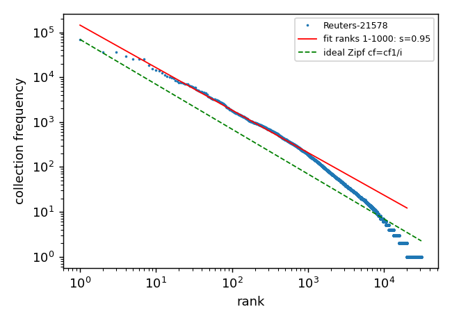
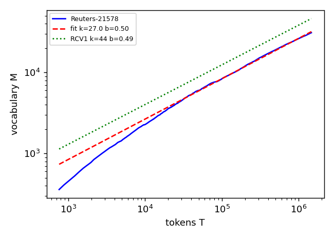
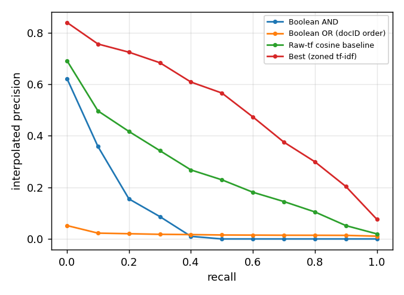

# Lexis: An Information Retrieval System

**Course:** CSL 436, Information Retrieval
**Term:** Winter 2026
**Slot:** F
**Group members:** *Add the names of all group members*
**Dataset:** Reuters-21578 collection, 10,788 articles
**Evaluation environment:** Windows, Python 3.13.5; 16 logical processors reported by Python

## Abstract

Lexis is a disk-based search engine for the Reuters-21578 news archive. It builds compressed positional inverted indexes using SPIMI or BSBI, supports four-shard index construction, Boolean/phrase/proximity/wildcard retrieval, spelling suggestions, document additions and deletions, and ranked free-text retrieval. The supplied exact-query set passed all 25 cases. On the 40 test queries, the tuned zoned tf-idf ranker achieved MAP 0.4988, precision@10 0.6325, and NDCG@10 0.5211. Measurements below were generated by the project scripts and are saved in `results.json`; the figures are `pr_curve.png`, `zipf.png`, and `heaps.png` in this directory.

## 1. Design and implementation

### 1.1 Text analysis

The analyzer lowercases text and tokenizes runs matching `[a-z0-9]+`. Stemming uses NLTK's Porter stemmer; stop-word removal is optional. The same analyzer is used for documents and queries. Positions are recorded before stop words are removed, preserving original token distances for phrase and proximity tests. Ranking experiments compare raw, stemmed, stop-word-filtered, and combined variants.

### 1.2 Index construction and storage

Documents are read as a stream. SPIMI accumulates term postings until its accounted memory limit is reached, writes a sorted block, and merges the blocks. BSBI uses a vocabulary pass and sorted term/document/position records. Both produce the same final index format. Parallel construction assigns contiguous document-ID ranges to four worker processes and merges their shard indexes.

The on-disk dictionary is front-coded. Postings store document-ID gaps and variable-byte encoded values, together with positional gaps and skip data. The engine maintains new documents in a delta segment and deleted document IDs in tombstones, so updates do not require rebuilding the main index.

### 1.3 Querying and ranking

The search engine supports Boolean operators, parentheses, quoted phrases, proximity queries, wildcards through a permuterm index, and spelling suggestions using character n-gram candidates and edit distance. Ranked retrieval uses cosine-style tf-idf weights with separate title and body zones. It accumulates candidates from query-term postings rather than scoring every document exhaustively. Champion lists and index elimination are also evaluated as pruning techniques.

## 2. Dataset and verification

The corpus contains 10,788 documents, 1,468,154 analyzed token occurrences, and 30,952 distinct unstemmed terms. Each of the four built analysis indexes contains all 10,788 documents.

| Check | Result |
|---|---:|
| Supplied Boolean queries | 10/10 passed |
| Supplied phrase queries | 7/7 passed |
| Supplied wildcard queries | 4/4 passed |
| Supplied proximity queries | 4/4 passed |
| **All supplied exact queries** | **25/25 passed** |
| Skip-table consistency check | Passed |
| New terms/documents retrievable after adding | Passed (2 documents) |
| Phrase query over newly added document | Passed |
| Deleted document excluded from results after reopening index | Passed |

For an independent check, the exact stage also tokenizes every lowercased corpus document and evaluates each query directly against those token lists without reading postings. The independent scan and indexed engine agreed on all 25 supplied queries (10 Boolean, 7 labeled phrase, 4 wildcard, and 4 proximity), and both agreed with every expected document-ID set. Three additional explicitly quoted corpus phrase queries also matched the brute-force scan: `"crude oil"` (231 documents), `"central bank"` (326), and `"bank of japan"` (126). The seven queries labeled `phrase` in the supplied TSV are unquoted two-word queries, so they are evaluated as implicit-AND queries by the query grammar; the added quoted checks exercise contiguous phrase matching directly.

For spelling, all 60 misspelled inputs were out of vocabulary. The intended correction was ranked first for 50/50 one-typo terms and 9/10 two-typo terms; all 60 intended corrections appeared in the top three. The top-ranked miss for `prokkects` was `prospects`; `projects` appeared second.

## 3. Vocabulary statistics

The Heaps fit is \(M = kT^b\), where \(M\) is the number of distinct terms observed after \(T\) tokens. The fit is computed over corpus prefixes with at least 1,000 tokens. The Zipf fit is \(f(r) = cr^{-s}\), with the 1,000 most frequent terms used for the focused fit.

| Fit | Parameters | R² |
|---|---|---:|
| Heaps, Reuters-21578 | \(k=26.99,\ b=0.4982\) | 0.9968 |
| Zipf, ranks 1–1,000 | \(c=144{,}574,\ s=0.9475\) | 0.9959 |
| Zipf, all 30,952 terms | \(c=10{,}893{,}959,\ s=1.5820\) | 0.9733 |

The assignment gives textbook Reuters-RCV1 Heaps values \(k=44,\ b=0.49\). The Reuters-21578 exponent is close to the reference exponent (difference 0.0082), while the fitted scale is lower (\(26.99\) versus \(44\)). This is a comparison across two related but different collections, not a claim that their vocabularies are identical.

## 4. Exact retrieval and positional index

Skip-pointer comparisons were counted for ten term pairs. “No skips” is the baseline; the remaining columns report comparison counts with skip spacing 4, 16, 64, and the implementation's square-root spacing. Counts depend on term-list lengths and data, so an individual spacing can require more comparisons than the no-skip baseline.

| Terms | df₁ | df₂ | Common docs | No skips | Spacing 4 | Spacing 16 | Spacing 64 | √df |
|---|---:|---:|---:|---:|---:|---:|---:|---:|
| said / opec | 6,784 | 126 | 119 | 6,627 | 2,291 | 2,120 | 4,282 | 4,861 |
| the / tanker | 6,951 | 35 | 34 | 6,819 | 1,896 | 960 | 1,575 | 1,865 |
| oil / opec | 1,038 | 126 | 120 | 1,026 | 708 | 956 | 1,039 | 1,052 |
| trade / deficit | 1,117 | 378 | 250 | 1,243 | 1,306 | 1,307 | 1,260 | 1,275 |
| bank / yen | 1,338 | 318 | 156 | 1,499 | 1,270 | 1,449 | 1,521 | 1,542 |
| wheat / corn | 327 | 209 | 90 | 443 | 508 | 467 | 449 | 464 |
| gold / silver | 229 | 62 | 49 | 242 | 252 | 256 | 245 | 260 |
| interest / rates | 839 | 563 | 289 | 1,113 | 1,266 | 1,168 | 1,128 | 1,142 |
| company / merger | 2,543 | 375 | 222 | 2,692 | 2,159 | 2,535 | 2,732 | 2,746 |
| price / coffee | 1,025 | 159 | 36 | 1,146 | 965 | 1,099 | 1,164 | 1,161 |
| **Total comparisons** |  |  |  | **22,850** | **12,621** | **12,317** | **15,395** | **16,368** |

Across these pairs, spacing 16 gave the fewest total comparisons, a 46.1% reduction from no skips. These measurements illustrate why spacing should be chosen empirically rather than assuming that every skip configuration improves every pair.

| Raw-index storage measurement | Bytes |
|---|---:|
| Positional postings | 3,725,907 |
| Plain (document, term-frequency) postings | 1,978,050 |
| Additional positional/skip overhead over plain postings | 1,747,857 |
| Positional-to-plain size ratio | 1.884× |

The dictionary is excluded from this positional-versus-plain postings comparison.

## 5. Index construction

The memory limit is the configured block-buffer limit. `Block bytes` is the total serialized partial-index data written. Peak block-building and peak merge memory are separately reported by Python's `tracemalloc`; they are not the configured buffer size and can exceed it. Times are one machine's measurements and should be treated as indicative rather than universal.

| Algorithm | Limit (KiB) | Blocks | Block bytes | Block time (s) | Total time (s) | Peak block memory (MiB) | Peak merge memory (MiB) |
|---|---:|---:|---:|---:|---:|---:|---:|
| SPIMI | 256 | 121 | 6,494,448 | 3.48 | 7.38 | 2.15 | 13.65 |
| SPIMI | 512 | 50 | 5,630,498 | 3.15 | 5.68 | 2.65 | 13.20 |
| SPIMI | 1,024 | 21 | 4,973,779 | 2.78 | 4.80 | 3.60 | 13.26 |
| SPIMI | 2,048 | 9 | 4,500,606 | 2.78 | 4.33 | 5.14 | 14.15 |
| BSBI | 256 | 45 | 5,541,137 | 5.30 | 7.68 | 7.24 | 15.86 |
| BSBI | 512 | 23 | 5,030,301 | 5.35 | 7.15 | 9.21 | 15.36 |
| BSBI | 1,024 | 12 | 4,629,965 | 5.08 | 6.72 | 13.01 | 15.05 |
| BSBI | 2,048 | 6 | 4,325,928 | 5.35 | 6.79 | 19.98 | 15.84 |

On these measurements, SPIMI was faster than BSBI at all four buffer limits. Larger limits reduced block count for both algorithms. The measured peak memory increased with the limit, and the merge phase had its own substantial memory peak.

| Algorithm | Shards | Shard-build phase (s) | Total elapsed (s) | Blocks |
|---|---:|---:|---:|---:|
| SPIMI | 1 | 4.39 | 5.74 | 9 |
| SPIMI | 2 | 4.28 | 5.72 | 10 |
| SPIMI | 4 | 3.28 | 4.98 | 12 |
| BSBI | 1 | 6.54 | 7.78 | 6 |
| BSBI | 2 | 5.43 | 6.87 | 6 |
| BSBI | 4 | 4.01 | 5.52 | 8 |

Using total elapsed times, the measured four-shard speedup over one shard was 1.15× for SPIMI (5.74/4.98 s) and 1.41× for BSBI (7.78/5.52 s). Parallelism improved elapsed time on this run, but did not produce linear speedup because indexing and final merging have overhead.

## 6. Compression

The following sizes are postings-only estimates over document-ID lists. “Uncompressed” stores each document ID in four bytes; “gaps” packs gaps at the minimum fixed bit width per list; variable-byte and gamma columns encode the positive gaps. Ratios are uncompressed size divided by encoded size. Dictionary bytes are measured separately in the index, not included in this table.

| Term group | Terms | Uncompressed (B) | Gaps (B) | Ratio | Variable byte (B) | Ratio | Gamma (B) | Ratio |
|---|---:|---:|---:|---:|---:|---:|---:|---:|
| All terms | 30,952 | 3,289,332 | 865,931 | 3.80× | 982,728 | 3.35× | 901,746 | 3.65× |
| 100 most frequent | 100 | 1,034,908 | 186,797 | 5.54× | 258,737 | 4.00× | 108,335 | 9.55× |
| Rarest 10,000 | 10,000 | 40,000 | 19,703 | 2.03× | 19,851 | 2.02× | 35,774 | 1.12× |

Gamma coding performed best for the frequent-term sample, while the rare-term sample's small gaps generally favored fixed-width gap packing or variable-byte coding. No single encoding was best for every frequency group.

## 7. Ranked retrieval

The ranker was tuned on the 40 training queries only. The best training configuration used the stemmed index with sublinear term frequency, idf, length normalization, and separate title/body zones enabled; the title-zone weight was `gt=0.1`. Test metrics below were then computed on the 40 held-out test queries.

| System | Split | MAP | Precision@10 | NDCG@10 |
|---|---|---:|---:|---:|
| Boolean AND | Train | 0.0772 | 0.3700 | 0.4144 |
| Boolean OR (document-ID order) | Train | 0.0221 | 0.0400 | 0.0285 |
| Raw-tf cosine baseline | Train | 0.3251 | 0.5825 | 0.5080 |
| Best zoned tf-idf | Train | **0.5593** | **0.7325** | **0.6247** |
| Boolean AND | Test | 0.0830 | 0.2975 | 0.3483 |
| Boolean OR (document-ID order) | Test | 0.0155 | 0.0150 | 0.0084 |
| Raw-tf cosine baseline | Test | 0.2505 | 0.4175 | 0.3635 |
| Best zoned tf-idf | Test | **0.4988** | **0.6325** | **0.5211** |

The Boolean baselines treat each free-text query as the set of its unique analyzed terms and return AND or OR matches; OR results are ordered by document ID. They are simple reference baselines, not ranked Boolean retrieval.

### Test-set 11-point interpolated precision-recall

Columns correspond to recall levels 0.0 through 1.0 in increments of 0.1.

| System | 0.0 | 0.1 | 0.2 | 0.3 | 0.4 | 0.5 | 0.6 | 0.7 | 0.8 | 0.9 | 1.0 |
|---|---:|---:|---:|---:|---:|---:|---:|---:|---:|---:|---:|
| Boolean AND | 0.622 | 0.358 | 0.155 | 0.086 | 0.010 | 0.000 | 0.000 | 0.000 | 0.000 | 0.000 | 0.000 |
| Boolean OR (document-ID order) | 0.052 | 0.022 | 0.020 | 0.018 | 0.017 | 0.015 | 0.015 | 0.014 | 0.014 | 0.014 | 0.011 |
| Raw-tf cosine baseline | 0.691 | 0.496 | 0.417 | 0.342 | 0.268 | 0.229 | 0.181 | 0.145 | 0.105 | 0.052 | 0.020 |
| Best zoned tf-idf | 0.839 | 0.756 | 0.724 | 0.683 | 0.608 | 0.566 | 0.473 | 0.375 | 0.299 | 0.203 | 0.076 |

The paired t-test comparing per-query test AP for the best system against the raw-tf baseline gave \(p=8.94\times10^{-12}\). The test set was not used to select the configuration.

## 8. Efficiency and pruning

The exhaustive baseline scores the union of documents in query-term postings. Measurements below average the 80 train and test queries. Overlap@10 is the fraction of the exhaustive top-10 results retained by a pruned run. Latency is milliseconds per query; pruning speedup is exhaustive latency divided by pruned latency. These are environment-specific measurements.

| Method | Overlap@10 | Mean documents scored | Latency (ms/query) | Speedup vs exhaustive |
|---|---:|---:|---:|---:|
| Exhaustive | 1.000 | 6,130.8 | 0.972 | 1.00× |
| Champion lists, r=10 | 0.310 | 46.0 | 0.252 | 3.86× |
| Champion lists, r=25 | 0.521 | 109.9 | 0.289 | 3.36× |
| Champion lists, r=50 | 0.708 | 207.8 | 0.348 | 2.79× |
| Champion lists, r=100 | 0.858 | 380.3 | 0.436 | 2.23× |
| Index elimination, idf ≥ 0.3 × max | 0.938 | 1,863.7 | 0.419 | 2.32× |
| Index elimination, idf ≥ 0.5 × max | 0.794 | 868.2 | 0.271 | 3.59× |
| Index elimination, idf ≥ 0.7 × max | 0.655 | 500.0 | 0.207 | 4.69× |

Champion-list size trades result overlap against latency. More aggressive index elimination reduced latency and the number of scored candidates, but also reduced top-10 overlap. These speed/quality tradeoffs should be considered together.

## 9. Ablation study

Each ablation is evaluated on the test queries against the training-selected best configuration (test MAP 0.4988). Reported p-values are paired tests on per-query AP: paired t-test and Wilcoxon signed-rank. A \(p<0.05\) is marked as statistically significant for this analysis; it should not be interpreted as proof of practical importance.

| Change from selected configuration | Test MAP | ΔMAP | Paired t-test p | Wilcoxon p |
|---|---:|---:|---:|---:|
| Stemming off | 0.4725 | -0.0263 | 0.0295 | 0.0172 |
| Stop words off (already off in selected configuration; no-op) | 0.4988 | 0.0000 | 1.0000 | 1.0000 |
| Stop words on (the meaningful opposite setting) | 0.4958 | -0.0030 | 0.1837 | 0.3427 |
| IDF off | 0.3764 | -0.1224 | 7.91×10⁻⁸ | 5.03×10⁻⁹ |
| Length normalization off | 0.4624 | -0.0363 | 0.2468 | 0.6559 |
| Zone weighting off | 0.5122 | +0.0134 | 0.0024 | 0.0008 |

The selected configuration already has stop-word removal disabled, so disabling it again is necessarily a no-op; the table also reports enabling stop-word removal as the actual one-factor change. The test-set ablation suggests that removing zone weighting improved MAP on this split. The chosen configuration remains the one selected on training data; test results were not used to retune it.

## 10. Limitations and interpretation

1. Exact-query verification independently scans all 10,788 documents for each of the 25 supplied queries. This establishes agreement for the supplied cases, not for every possible query string.
2. The spelling checker achieved top-3 accuracy of 60/60, but top-1 accuracy was 59/60 overall.
3. Construction, memory, and latency numbers depend on the Windows machine, Python build, process scheduling, and filesystem cache. Peak values are `tracemalloc` measurements and should not be read as total operating-system process memory.
4. The corpus and textbook RCV1 reference are different datasets. The Heaps comparison is informative, not an exact reproduction target.
5. The report gives generated measurements; design choices and implementation tradeoffs should be defended in the accompanying presentation or discussion.

## 11. Conclusion

The implementation meets the assignment's core feature checklist in the supplied evaluation: four-shard construction, SPIMI and BSBI block construction, compressed positional postings, Boolean/phrase/wildcard/proximity search, spelling suggestions, ranked retrieval, pruning measurements, and persistent add/delete behavior are present. All 25 supplied exact-query cases passed. The strongest test-set ranking result was the training-selected zoned tf-idf system, with MAP 0.4988 and precision@10 0.6325. The saved experiment artifacts support the required analysis while also exposing limitations in spelling top-1 accuracy, pruning overlap, and the absence of a separately executed brute-force oracle.
